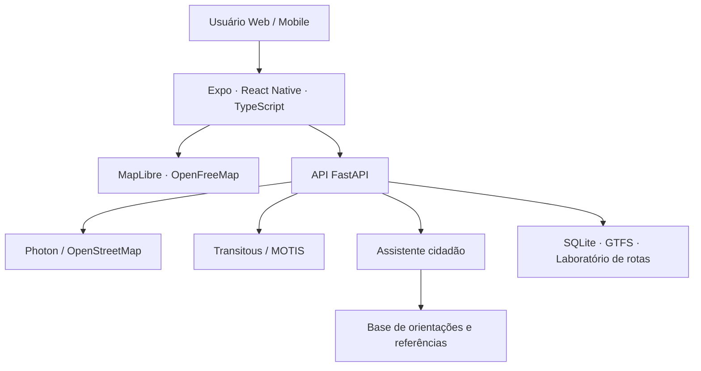

<div align="center">


**Tecnologia a serviço de cidades mais conectadas, inclusivas e humanas.**


[Sobre](#sobre-o-projeto) · [Funcionalidades](#funcionalidades) · [Execução](#como-executar-localmente) · [API](#endpoints) · [Equipe](#equipe)

</div>

---

## Sobre o projeto

O **Citizen Tech — Mobilidade Urbana** é um protótipo acadêmico da Global Solution 2026.2 da FIAP, desenvolvido para facilitar o planejamento de deslocamentos em São Paulo e ampliar o acesso a informações cidadãs.

A proposta reúne planejamento de trajetos, mapas interativos e um assistente inteligente em uma única plataforma web e mobile, com atenção especial às necessidades de pessoas com deficiência física e mobilidade reduzida.

### Nossa proposta

| Desafio | Solução proposta |
|---|---|
| Informações de transporte dispersas | Consulta centralizada de trajetos e orientações |
| Dificuldade para planejar deslocamentos | Mapa, busca de endereços e itinerários multimodais |
| Barreiras de mobilidade | Preferências de caminhada e indicação transparente de dados de acessibilidade não verificados |
| Dúvidas sobre serviços e direitos | Assistente cidadão com referências e limites explícitos |

## Funcionalidades

<div align="center">
<table>
<tr>
<td width="33%"></td>
<td width="33%"></td>
<td width="33%"></td>
</tr>
<tr><td align="center"><b>Metrô e trem</b></td><td align="center"><b>Ônibus</b></td><td align="center"><b>Caminhada</b></td></tr>
</table>
</div>

- Busca de endereços pelo Photon / OpenStreetMap, GPS autorizado ou seleção no mapa;
- Mapa MapLibre com OpenFreeMap Positron, trajetos de caminhada, ônibus e metrô/trem coloridos;
- Planejamento multimodal via Transitous/MOTIS: linhas, estações, embarque, desembarque e baldeações quando o provedor informa;
- Preferência **priorizar menos caminhada** e registro de necessidade de percurso sem escadas, com aviso de **acessibilidade não verificada**;
- Módulo acadêmico de análise de passagem sem degraus (dados de exemplo, sem comprovação de campo);
- Assistente cidadão com base local; módulo adicional de classificação em `/assistente`;
- Motor de rotas e tarifas **simuladas**, isolado no laboratório;
- Infraestrutura de banco SQLite, migrações e importador GTFS (uso mediante fonte de dados adequada).

## Arquitetura e tecnologias



| Camada | Tecnologias |
|---|---|
| Interface | React Native, Expo, TypeScript |
| Backend | Python, FastAPI, Uvicorn |
| Mapas | MapLibre, OpenFreeMap |
| Geocodificação | Photon / OpenStreetMap |
| Transporte | Transitous / MOTIS, GTFS |
| Inteligência artificial | Classificação, busca e base de orientações |
| Persistência acadêmica | SQLite |
| Qualidade | Pytest, TypeScript, GitHub Actions |

## Estrutura

| Diretório | Responsabilidade |
|---|---|
| `frontend/` | Expo, React Native, TypeScript, Web e aplicativo |
| `frontend/components/MapaPreview.web.tsx` | MapLibre no navegador |
| `frontend/components/MapaPreview.tsx` | MapLibre em WebView no mobile |
| `backend/src/api.py` | FastAPI e montagem dos endpoints |
| `backend/src/transitous_api.py` | Planejamento com dados de transporte |
| `backend/src/enderecos_api.py` | Geocodificação e consulta de rotas |
| `backend/src/acessibilidade.py` | Analisador de dados de passagem sem degraus |
| `backend/src/acessibilidade_api.py` | API de avaliação, sem verificação em campo |
| `backend/src/assistente/` | Classificador e assistente |
| `backend/src/rotas/` | Algoritmos do laboratório acadêmico |
| `backend/src/db/` | SQLite e migrações |
| `backend/src/transporte/` | Importador GTFS |
| `docs/` | PRD, documentação e roteiro de implantação |

## Como executar localmente

### Pré-requisitos

Git, Python compatível com as dependências de `backend/requirements.txt`, Node.js e npm.

### 1. Clone o projeto

```powershell
git clone https://github.com/lucasgesini45-coder/Global-solution-Citizen-tech.git
cd Global-solution-Citizen-tech
```

### 2. Inicie o backend

Na raiz do projeto, no PowerShell:

```powershell
python -m venv .venv
.\.venv\Scripts\python.exe -m pip install -r backend/requirements.txt
.\.venv\Scripts\python.exe -m uvicorn backend.src.api:app --reload --port 8000
```

Acesse [Swagger UI](http://127.0.0.1:8000/docs) ou [Health](http://127.0.0.1:8000/health).

### 3. Inicie o frontend

Abra outro terminal na raiz:

```powershell
cd frontend
npm install
Copy-Item .env.example .env
npx expo start --web --clear
```

Se já existir um arquivo `.env`, preserve suas configurações em vez de copiá-lo novamente. Abra o endereço exibido pelo Expo e mantenha os dois terminais em execução.

### 4. Teste no celular (opcional)

Configure `EXPO_PUBLIC_API_URL` em `frontend/.env` com o IP local do computador, inicie o backend com `--host 0.0.0.0` em uma rede confiável e execute `npx expo start` no frontend. O endereço `127.0.0.1` no celular não aponta para o computador.

## Endpoints

| Método | Endpoint | Uso |
|---|---|---|
| GET | `/health` | Verificar API |
| GET | `/temas` | Temas do assistente original |
| POST | `/consultar` | Orientação com referências locais |
| GET | `/enderecos/sugestoes?q=...` | Buscar endereços |
| POST | `/rotas/reais` | Consultar trajeto multimodal |
| POST | `/acessibilidade/avaliar` | Analisar dados de passagem sem degraus **fornecidos** |
| GET | `/assistente/saude` | Estado do classificador |
| POST | `/assistente/perguntar` | Consulta ao classificador |
| POST | `/agente/conversar` | Chat integrado: respostas acadêmicas, informações verificadas e rotas reais com atualização no mapa |
| GET | `/rotas/exemplo` | Simulação acadêmica |
| POST | `/rotas` | Motor simulado |

O chat do frontend utiliza `POST /agente/conversar` e envia a pergunta, origem e destino selecionados, modal e preferências. Quando o backend retorna `rota` com geometria válida, o frontend sincroniza o mapa. A ausência de dados oficiais para benefícios e acessibilidade não é substituída por uma afirmação gerada pelo classificador.

O corpo de `POST /rotas/reais` permite:

```json
{
  "origem": {"lat": -23.5505, "lon": -46.6333},
  "destino": {"lat": -23.5580, "lon": -46.6610},
  "modal": "ferroviario",
  "priorizar_menos_caminhada": true,
  "evitar_escadas": true
}
```

`evitar_escadas` **não filtra com garantia** as barreiras reais: sinaliza a necessidade e retorna status `NAO_VERIFICADA` até integrar evidências confiáveis.

## Testes

```powershell
.\.venv\Scripts\python.exe -m pytest backend/tests -v
cd frontend
npx tsc --noEmit
```

GitHub Actions executa os testes do backend e o typecheck do frontend nos pull requests. Não confunda testes automatizados com homologação de percursos reais.

## Próximas entregas do PRD

Consulte [o plano de integração e evolução](docs/PLANO_EXECUCAO_PRD.md). Prioridades: validar dados oficiais de acessibilidade, exibir alternativas reais, reduzir trajetos a pé inadequados, confirmar horários por operadora, testes manuais Web/mobile e finalizar a avaliação acadêmica do assistente.

## Integração do grupo

- `evolucao-v2` → `main`: PR #3 (banco, GTFS, assistente, motor e testes);
- `raphael/acessibilidade` → `main`: código integrado e documentado no PR #4 para resolver o conflito no PR #2;
- `ia-integrada`, `integracao/citizen-mobilidade`, `part2-tarifas` e `feat/estrutura-inicial-citizen-mobilidade`: mudanças já ancestrais da `main`.

**FIAP Global Solution — protótipo educacional; não use suas previsões como única base para deslocamento seguro.**


## Equipe

<div align="center">
<table>
<tr>
<td align="center"><a href="https://github.com/lucasgesini45-coder"><br><b>Lucas Ribeiro Gesini</b></a></td>
<td align="center"><a href="https://github.com/raphafreitass1982"><br><b>Raphael de Freitas Silva</b></a></td>
<td align="center"><a href="https://github.com/xsindgy"><br><b>@xsindgy</b></a></td>
</tr>
</table>
</div>

*Integrantes e colaboradores identificados nos registros do repositório. Lista acadêmica completa e RMs a confirmar.*

## Aviso de responsabilidade

Este projeto é educacional e não representa Metrô, CPTM, SPTrans ou outros operadores. Tarifas, horários, segurança e acessibilidade podem não estar confirmados. A preferência por evitar escadas não garante uma rota livre de barreiras. Consulte fontes oficiais antes de viajar.

<div align="center">

**FIAP | Ciência da Computação | Global Solution 2026.2**


</div>
